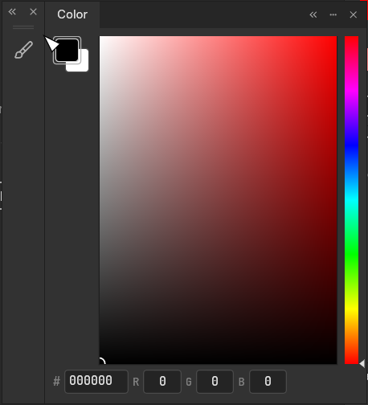
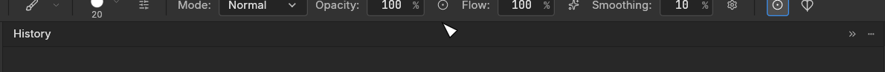

Draft: current upstream `b1cfff9d3` is integrated; all five conflicts are resolved. Focused panel validation is complete. Contributor desktop acceptance and the documented non-green upstream gates remain open.

Panel moves, compact flyouts, and resize gestures now use the same fitted geometry as the shared docking workspace. This fixes doubled seams and input, lost outlines, overlapping panels, and ambiguous docking previews. Compact parts keep their own state and normal editor sizes when joined, resized, collapsed, or detached.

The final transitions are covered explicitly: a full editor joined beside a short compact palette retains its height on join and detach; a collapsed top/bottom group remains attached as a tab bar and accepts tabs before, between, and after existing tabs. Floating Tools can move only as a whole and resize on both axes. Ordinary layer selection keeps Properties closed; adjustment/fill reveal remains available.

The adapter keeps one serialized shared workspace and token-derived chrome. `vendor/craft-ui` is an explicit snapshot of immutable revision `92d392cff132eaf53e13afff77f38b5c11b73aa0`, with six Rust files changed for optional host hooks, fitted rectangles, and resize chrome. The remaining snapshot source is unchanged. Other craft-libs dependencies retain immutable pins. A build-time revision contract detects a stale override when the shared UI/egui pins change; restore fallback preserves unreadable layouts. See [the integration contract](https://github.com/KotovGGG/photocraft/blob/1c53e40a853acdde3b367162f24c00cd8e650441/docs/panel-docking-contract.md) and [shared patch/testing notes](https://github.com/KotovGGG/photocraft/blob/1c53e40a853acdde3b367162f24c00cd8e650441/vendor/craft-ui/PATCH.md).

| Transition | Before | After |
|---|---|---|
| Join full editor to compact palette |  |  |
| Collapse a top-attached group |  |  |

Contributor before captures and deterministic offscreen after captures show equivalent transitions with different theme/localization settings. [Reproduction and image provenance](https://github.com/KotovGGG/photocraft/blob/1c53e40a853acdde3b367162f24c00cd8e650441/docs/panel-docking-demo.md).

Validation of the merged source (upstream `b1cfff9d3`):

- 136 panel tests passed (two opt-in benchmarks ignored), plus dependency-contract, dock, workspace, whole Tools, type/screen-mode flyout, visibility and overflow filters.
- 2762 engine tests passed (22 ignored); adversarial `panic_hunt` passed separately.
- 346 shared docking tests and 9 workspace integration tests passed.
- fmt, 31-crate layers, 24-crate wasm plus codecs/heif, parity/scorecard generation, UI/engine doctest checks (zero examples), and shared Clippy passed.
- 570 fresh offscreen matrix PNGs, 72 physical-pixel seam assertions, 515 replay PNGs and 15 refreshed GIFs. The two after images above come from the merged source; core source hashes stayed unchanged throughout validation.
- The full UI **library** run is **not green**: 4460 passed, 95 failed, 23 ignored. 92 failure names match the historical record; three additional unchanged upstream font Probe tests select the installed Inter Hewn family instead of Inter after ArrowDown+Enter. Those Probes render Character/options without docking. A new independent full baseline of current upstream and the complete workspace suite were not run.
- Strict UI/engine all-targets Clippy is also **not green**. The standard command stops at upstream `text/src/psd_path.rs:157`; targeted `--no-deps` diagnostic runs expose six further locations in crop/painting/dialog/widget code. All six affected files have no diff from upstream/main. No lint/CI suppression or unrelated fixes were added. Shared Clippy passed separately.

[Current validation and limits](https://github.com/KotovGGG/photocraft/blob/1c53e40a853acdde3b367162f24c00cd8e650441/docs/panel-docking-validation.md). [Fresh logs, SHA manifests, raw captures and GIF package](https://github.com/KotovGGG/photocraft/tree/codex/panel-layout-handoff-2026-10-30/plan/panel-repair/home-portable-2026-10-30). Historical CPU timings and old baseline records are kept separately; they are not acceptance of the merged source.

Native Windows focus/IME, physical monitors, mixed DPI and real GPU stalls still require the contributor's desktop build. The product EXE was not built or launched by the agent. This PR remains a draft until that acceptance and review of the documented non-green gates.

Scope is panel UI, shell command registrations, and the existing auto-show preference wiring. No action-name/text, ATN/PSD, contributor-credit, or CI changes relative to current main. Related to #217.
