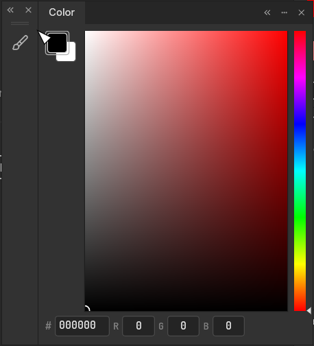
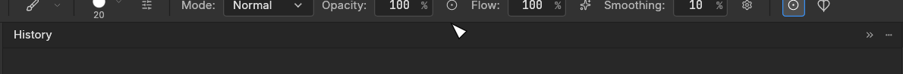

Panel moves, compact flyouts, and resize gestures now use the same fitted geometry as the shared docking workspace. This fixes doubled seams and input, lost outlines, overlapping panels, and ambiguous docking previews. Compact parts keep their own state and normal editor sizes when joined, resized, collapsed, or detached.

The final transitions are covered explicitly: a full editor joined beside a short compact palette retains its height on join and detach; a collapsed top/bottom group remains attached as a tab bar and accepts tabs before, between, and after existing tabs. Floating Tools can move only as a whole and resize on both axes. Ordinary layer selection keeps Properties closed; adjustment/fill reveal remains available.

The adapter keeps one serialized shared workspace and token-derived chrome. `vendor/craft-ui` is an explicit snapshot of immutable revision `92d392cff132eaf53e13afff77f38b5c11b73aa0`, with six Rust files changed for optional host hooks, fitted rectangles, and resize chrome. The remaining snapshot source is unchanged. Other craft-libs dependencies retain immutable pins. A build-time revision contract detects a stale override when the shared UI/egui pins change; restore fallback preserves unreadable layouts. See [the integration contract](https://github.com/KotovGGG/photocraft/blob/cd571efe41c556347b1851ac208e3388acc3002e/docs/panel-docking-contract.md) and [shared patch/testing notes](https://github.com/KotovGGG/photocraft/blob/cd571efe41c556347b1851ac208e3388acc3002e/vendor/craft-ui/PATCH.md).

| Transition | Before | After |
|---|---|---|
| Join full editor to compact palette |  |  |
| Collapse a top-attached group |  |  |

Contributor before captures and deterministic offscreen after captures show equivalent transitions with different theme/localization settings. [Reproduction and image provenance](https://github.com/KotovGGG/photocraft/blob/cd571efe41c556347b1851ac208e3388acc3002e/docs/panel-docking-demo.md).

Validation against upstream `382b047c3`:

- 136 panel tests passed (two opt-in benchmarks ignored in the regular filter); dependency contract and related docking/workspace/Tools/visibility/overflow filters passed.
- 2711 engine tests passed; adversarial command `panic_hunt` passed separately.
- 346 shared docking tests passed with the documented optional test inputs.
- Formatting, UI/engine all-targets Clippy, shared-library Clippy, engine/UI doctest checks, 31-crate layer check, 24-crate wasm plus codecs/heif, and parity/scorecard regeneration passed.
- 570 offscreen matrix PNGs across three Pro themes and 100/125/150/200% scale, including the sanitized problem layout, plus 515 replay frames; 72 physical-pixel seam checks passed.
- Five scoped CPU hover/drag runs completed; reproduction and results are in [validation notes](https://github.com/KotovGGG/photocraft/blob/cd571efe41c556347b1851ac208e3388acc3002e/docs/panel-docking-validation.md).
- The full UI run is **not green**: 92 failures. 92 match independently recorded historical baseline failures; 0 do not match that record. This is separate from the passing panel suite.

Native Windows capture previously timed out. Physical monitor/mixed-DPI/IME interaction remains to be checked using the contributor's desktop build; the main application EXE was not built as part of this repair.

Scope is panel UI, shell command registrations, and the existing auto-show preference wiring. No action-name/text, ATN/PSD, contributor-credit, or CI changes. Related to #217.
