Panel moves and resize gestures now follow the shared workspace's fitted geometry. This repairs compact rows tearing off as wide strips, editors inheriting miniature heights, closed tabs appearing selected, overlapping/missing seams, and compound resizing that changes neighbours or ignores the bottom corners.

### Behavior

- Dock panels above or immediately below document tabs, and above/below another panel within a group. Collapsed top/bottom rows remain attached and accept tab insertion before, between and after existing tabs.
- Tear a collapsed row off as a compact palette; an expanded editor retains its normal floating size. Joining a full editor to a short compact owner preserves its height on join and detach.
- Collapse neighbouring parts independently, resize the middle floating part without resizing its neighbours, and resize a group's bottom edge/corners before changing its width. Repeated collapse/expand restores normal group heights.
- Move Tools only as a whole palette and resize it on both axes. Ordinary layer selection keeps Properties closed; adjustment/fill reveal remains available.
- Keep one serialized shared `Workspace`, legacy/unsupported-layout recovery, and token-derived single-owner seams and outlines.

### Integration and scope

Current main `422ca7beda90d927643bcd074646ebbd37706d75` is integrated; all merge conflicts are resolved. The explicit `vendor/craft-ui` snapshot is reconciled with main's immutable `c5a1cbfb5f9049f9270955caffb5bee5997aebf7` revision. Of its source files, 76 match upstream; six contain the documented optional host hooks/geometry patch. The build-time revision contract remains enforced and egui's pin is unchanged.

Review the [host/shared contract](https://github.com/KotovGGG/photocraft/blob/7005992d2083e36315be404603e438976857e65c/docs/panel-docking-contract.md) and [local shared-library patch](https://github.com/KotovGGG/photocraft/blob/7005992d2083e36315be404603e438976857e65c/vendor/craft-ui/PATCH.md). Scope is panel UI, shell command registrations, persistence and existing auto-show wiring. No CI, ATN/PSD, action-name/text or contributor-credit changes relative to main. The two earlier CodeRabbit documentation findings are fixed.

### Validation and acceptance

Validated code: `88da5a9142c9c55bbb9fb93abe8ddc5192f83929`; later commits extend only the test-only replay harness and documentation/assets; runtime code is unchanged.

- **165 panel-filter tests** (including the new opt-in replay entry), **579 shared UI tests** (including 346 docking tests), and **9 workspace integration tests** passed.
- Desktop all-targets `cargo check`, fmt, 31-crate layering, and 24-crate wasm plus codecs/heif checks passed.
- **13 caption-free gesture GIFs** are backed by 887 fresh replay frames. Both replay runs and decoded-pixel/timing checks passed.
- **444 fresh offscreen PNGs**, three Pro themes, 100/125/150/200% scale; all four capture runs and their seam assertions passed. The after PNGs and GIFs were regenerated on the integrated code.
- **Full UI library suite is not green:** 4494 passed, 95 failed, 23 ignored. All 95 failure names exactly match the pre-merge repaired v0.18.0 snapshot; this is not an independently rerun clean-main baseline.
- **Strict Clippy is not green:** unchanged main text/UI findings and a boolean-style finding in unchanged pinned shared-library `docking/render/preview.rs`. No suppressions or unrelated fixes were added. Exact commands, locations and limitations are in the [validation notes](https://github.com/KotovGGG/photocraft/blob/7005992d2083e36315be404603e438976857e65c/docs/panel-docking-validation.md).

The contributor rebuilt and tested the repaired v0.18.0 Windows EXE and reported no remaining major panel issues. That manual acceptance preceded the final main/shared-widget merge; the integration has the automated coverage above. Native focus/IME, physical mixed-DPI/monitor coverage and GPU/input latency are not separately certified. The agent did not build or launch the product EXE.

### Panel demonstrations — 13 GIFs

Recorded pointer gestures, fixed close crops, and pauses around each action. No caption overlays.

Docking and tab placement (5 GIFs)

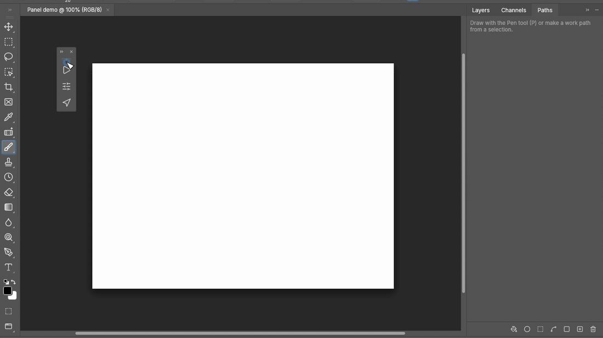

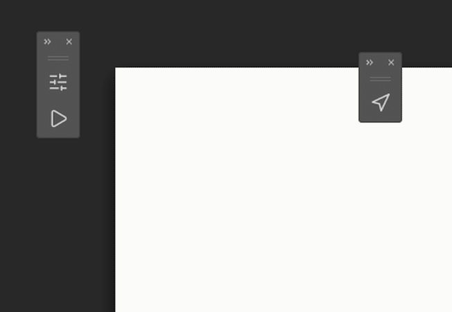

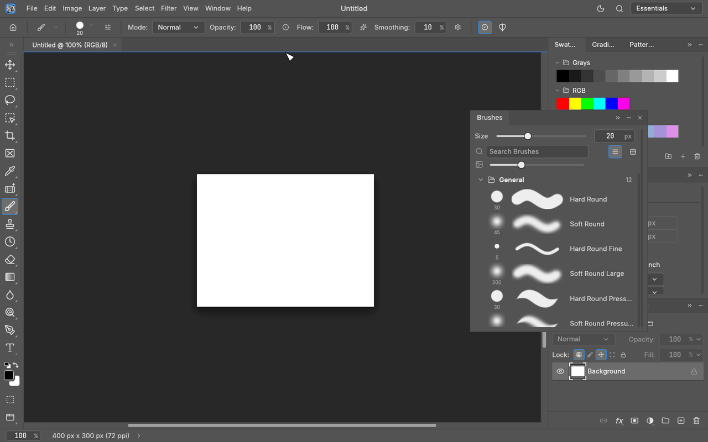

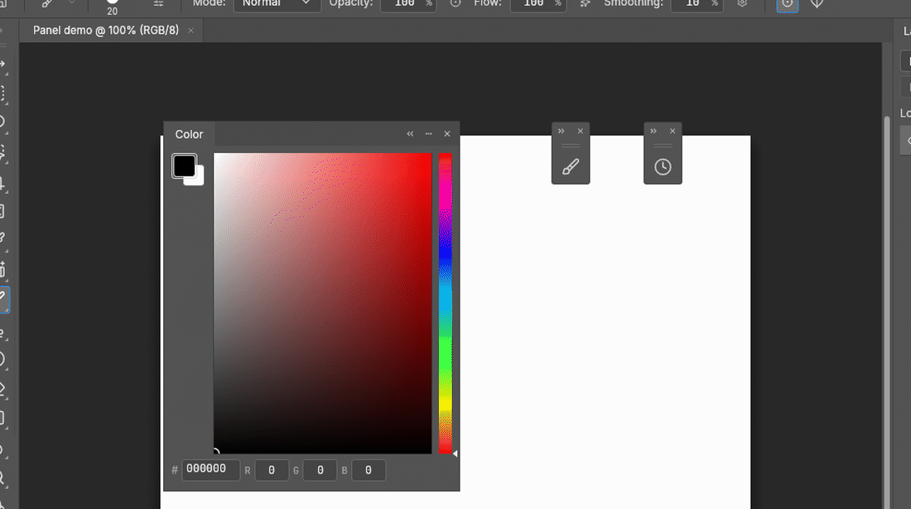

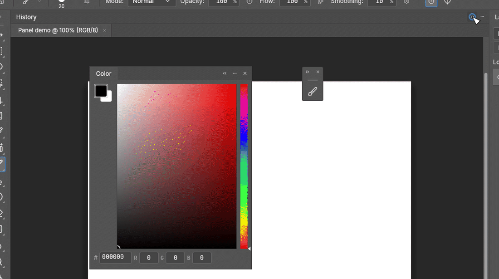

Compact palettes and editor sizes (4 GIFs)

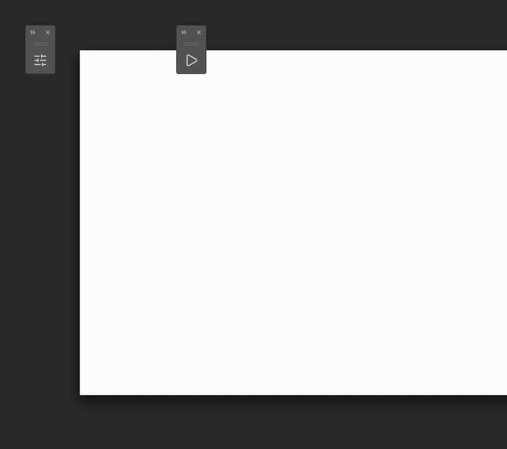

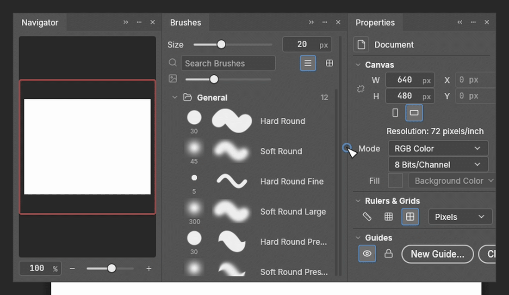

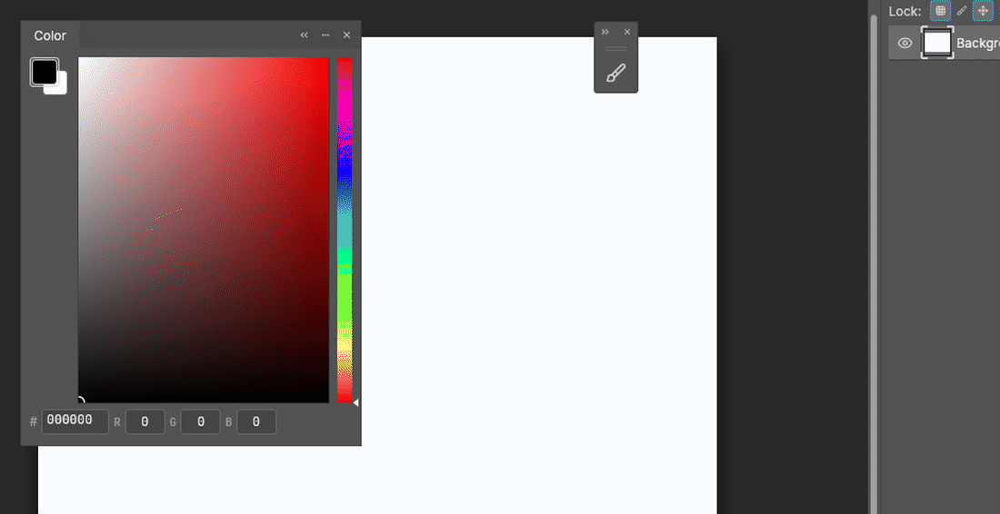

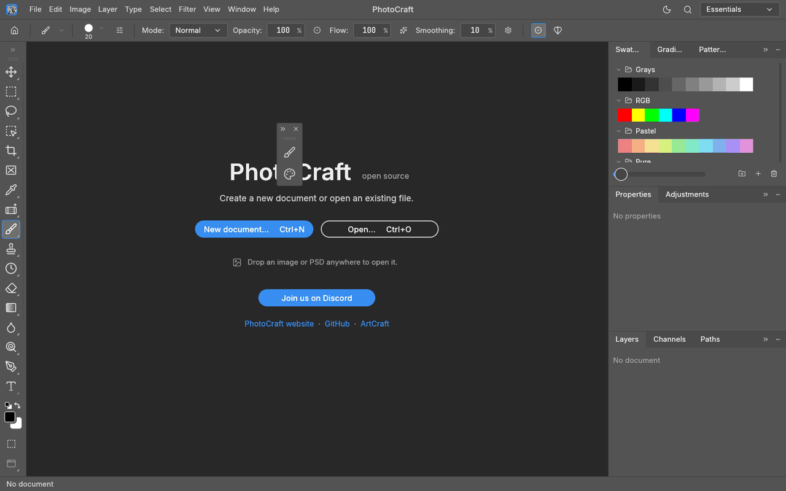

Resizing and Tools (4 GIFs)

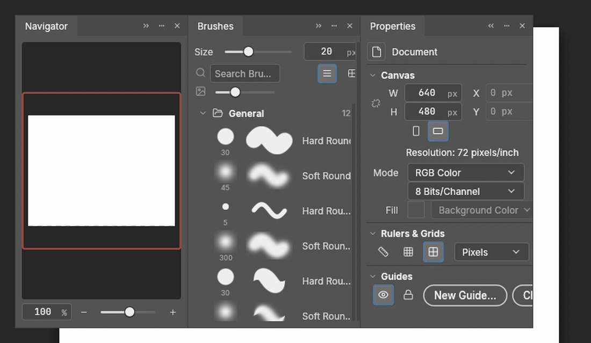

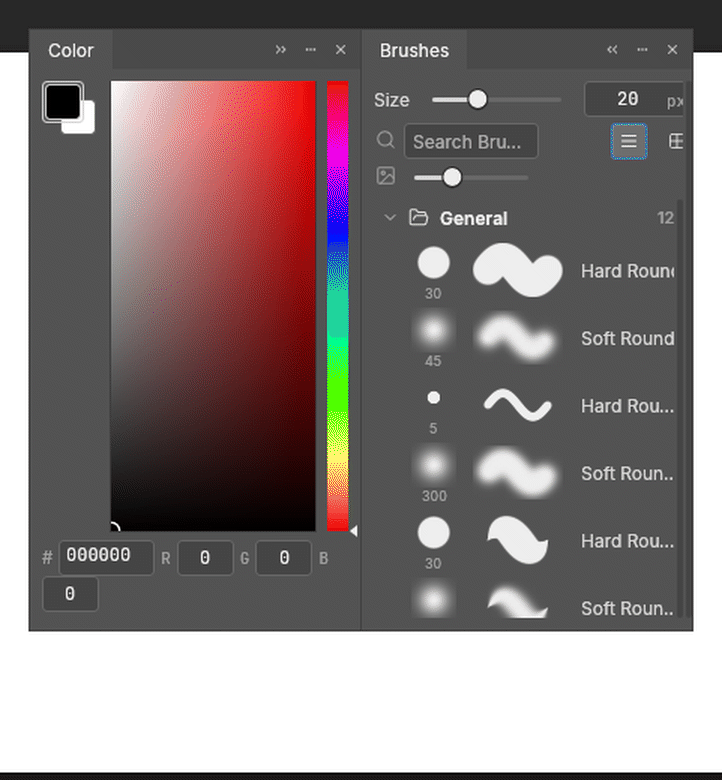

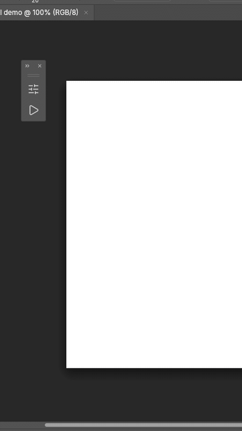

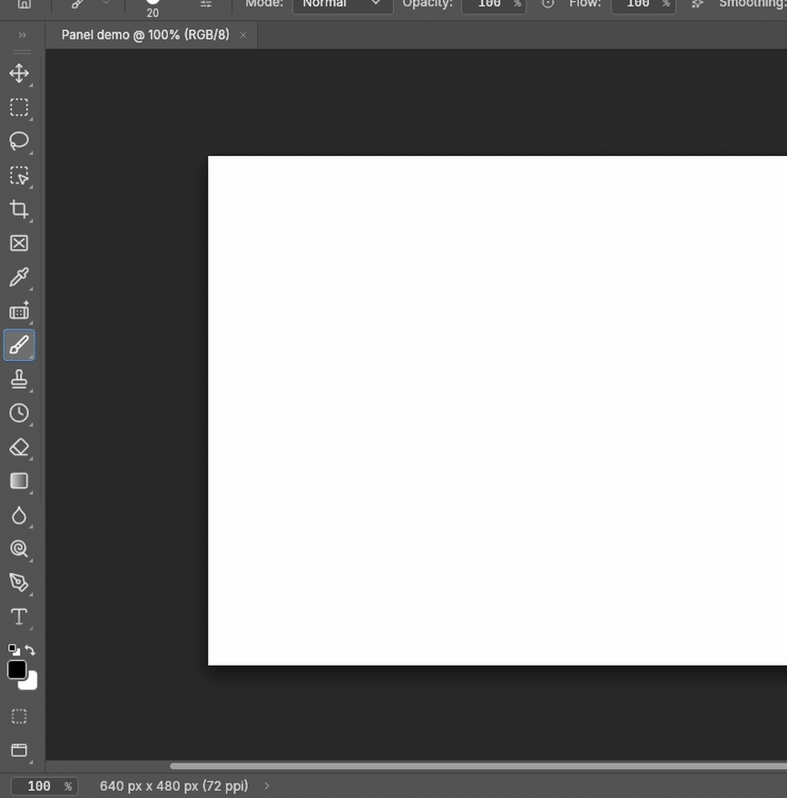

These are offscreen replays with synthetic blank documents, not native desktop video or latency measurements. Provenance and licenses are adjacent to the assets.

Related to #217.
