> **Review split in progress:** the focused shared docking API patch is now [craft-libs #470](https://github.com/storytold/craft-libs/pull/470) (9 files). Please review that dependency first. This PR preserves the complete tested implementation; smaller dependent PhotoCraft integration/persistence, compact/resize and Tools PRs will follow.

Panel moves and resize gestures now follow the shared workspace's fitted geometry. This repairs compact rows tearing off as wide strips, editors inheriting miniature heights, closed tabs appearing selected, overlapping/missing seams, and compound resizing that changes neighbours or ignores the bottom corners.

### Behavior

- Dock panels above or immediately below document tabs, and above/below another panel within a group. Collapsed top/bottom rows remain attached and accept tab insertion before, between and after existing tabs.
- Tear a collapsed row off as a compact palette; an expanded editor retains its normal floating size. Joining a full editor to a short compact owner preserves its height on join and detach.
- Collapse neighbouring parts independently, resize the middle floating part without resizing its neighbours, and resize a group's bottom edge/corners before changing its width. Repeated collapse/expand restores normal group heights.
- Move Tools only as a whole palette and resize it on both axes. Ordinary layer selection keeps Properties closed; adjustment/fill reveal remains available.
- Keep one serialized shared `Workspace`, legacy/unsupported-layout recovery, and token-derived single-owner seams and outlines.

### Integration and scope

Current main `422ca7beda90d927643bcd074646ebbd37706d75` is integrated; all merge conflicts are resolved. The explicit `vendor/craft-ui` snapshot is reconciled with main's immutable `c5a1cbfb5f9049f9270955caffb5bee5997aebf7` revision. Of its source files, 76 match upstream; six contain the documented optional host hooks/geometry patch. The build-time revision contract remains enforced and egui's pin is unchanged.

Review the [host/shared contract](https://github.com/KotovGGG/photocraft/blob/7005992d2083e36315be404603e438976857e65c/docs/panel-docking-contract.md) and [local shared-library patch](https://github.com/KotovGGG/photocraft/blob/7005992d2083e36315be404603e438976857e65c/vendor/craft-ui/PATCH.md). Scope is panel UI, shell command registrations, persistence and existing auto-show wiring. No CI, ATN/PSD, action-name/text or contributor-credit changes relative to main. The two earlier CodeRabbit documentation findings are fixed.

### Validation and acceptance

Runtime tested: `a4077cb15a240549715b16e2075ce6c3ec8e2420`, incorporating main `799e12962806dac2d8b1a319bd386042dcbd61e4`. Later changes update documentation/PNG provenance only.

- **167 panel-filter tests** and **9 workspace integration tests** passed. Desktop all-targets `cargo check`, fmt, 31-crate layering and 24-crate wasm plus codecs/heif checks passed.
- All four capture runs and seam assertions passed: **444 fresh offscreen PNGs**, three Pro themes at 100/125/150/200%. Their central regions match the previous matrix pixel-for-pixel; full frames differ in app chrome outside that region. Both after PNGs were refreshed.
- The **13 caption-free GIFs** retain their documented source at `7005992d2` (887 replay frames). They illustrate the gestures and are not a fresh replay of the latest merge.
- The shared dependency PR's latest validation at `4f263ed`: **590 unit, 10 integration, 8 doctests passed** (2 doctests ignored). The consumer's tested vendor patch is `235fffbd`; a subsequent shared-only docked-custom-group fix is outside PhotoCraft's floating-only ownership path. Accepted upstream pin/removal of vendor remains the next integration gate.
- **Full UI library suite is not green:** sequential run **4640 passed, 97 failed, 23 ignored**. All prior 95 failure names reoccur; the other two are tests added upstream. No clean-main rerun establishes those two as baseline failures. An earlier parallel attempt exited without a complete summary.
- **Strict Clippy is not green:** unchanged main IO/UI findings, plus the documented unchanged shared-library findings. Shared workspace tests hit the documented Rust 1.95 MSVC compiler ICE. No suppressions or unrelated fixes were added.
- The required `perf --quick` release examples are still building; no quick-run result is claimed yet. Exact commands, failure names, scope and remaining gates are in the [validation notes](https://github.com/KotovGGG/photocraft/blob/adaae9cd48832486b268fbfd2f79e85cd3b6ed6d/docs/panel-docking-validation.md).

The contributor's successful Windows EXE check predates this latest main merge. The agent did not build or launch the product EXE. Native focus/IME, physical mixed-DPI monitors and GPU/input latency are not certified by the automated checks above.

### Panel demonstrations — 13 GIFs

Recorded pointer gestures, fixed close crops, and pauses around each action. No caption overlays.

Docking and tab placement (5 GIFs)

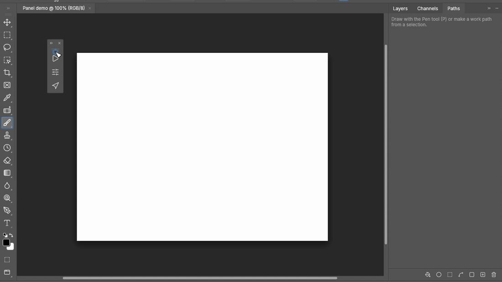

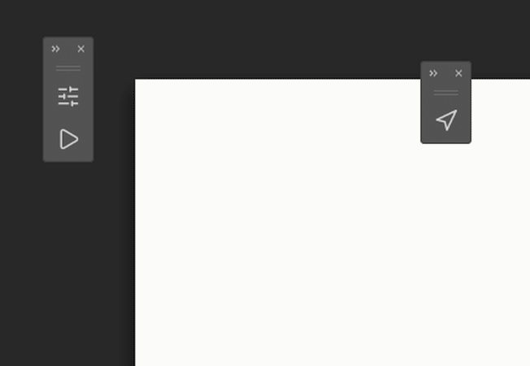

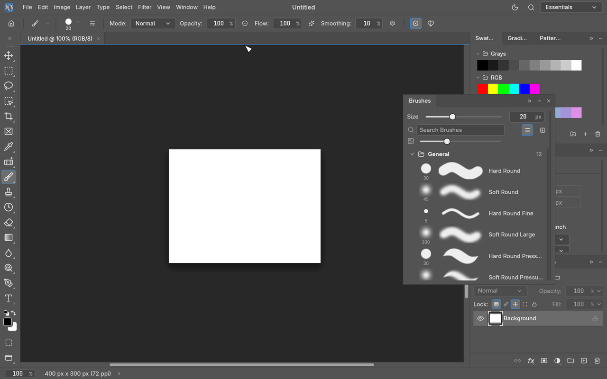

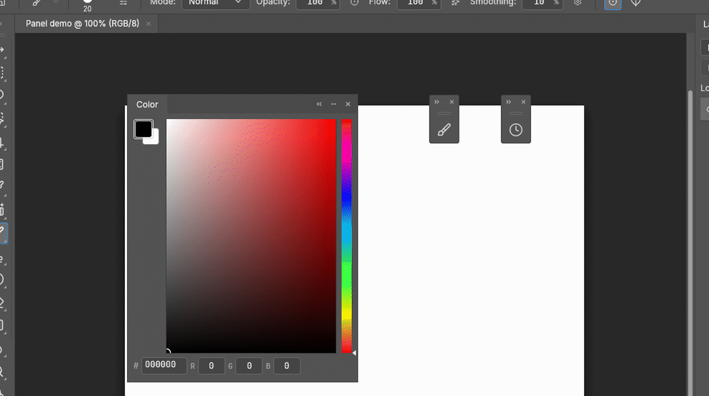

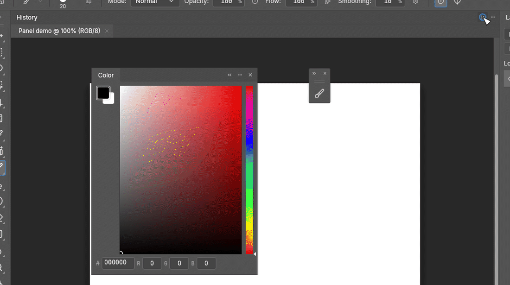

Compact palettes and editor sizes (4 GIFs)

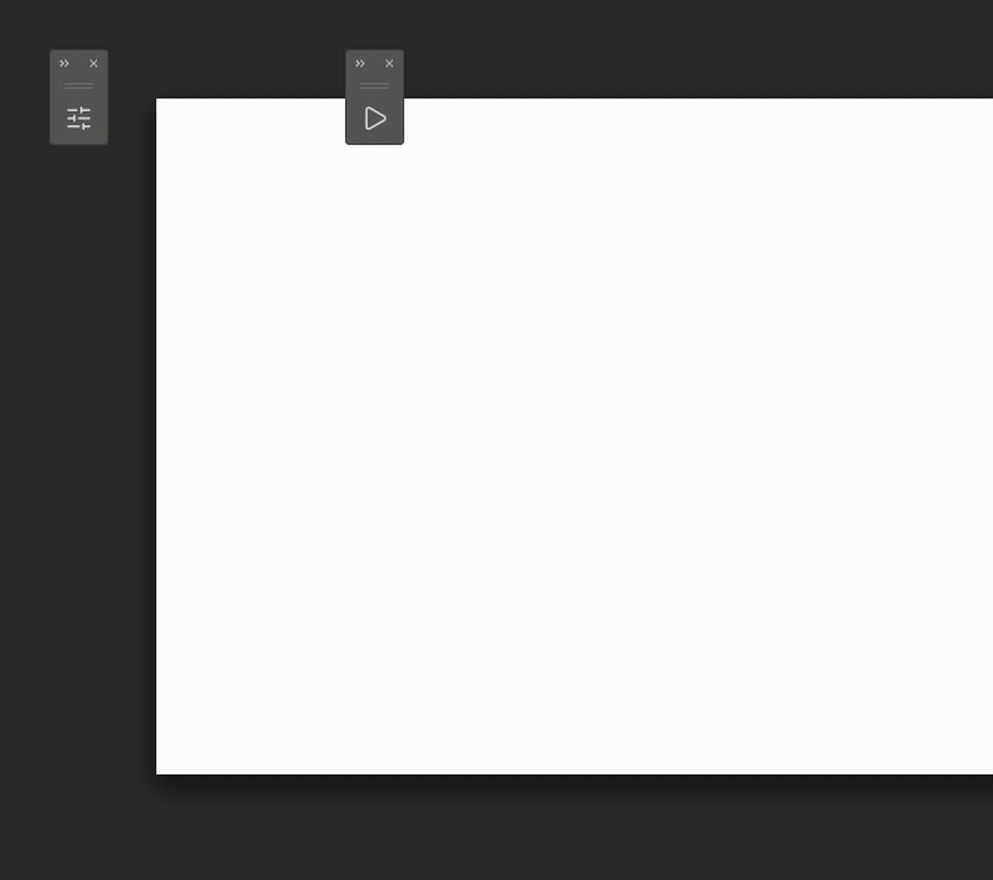

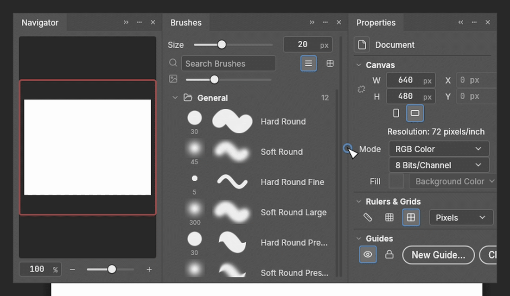

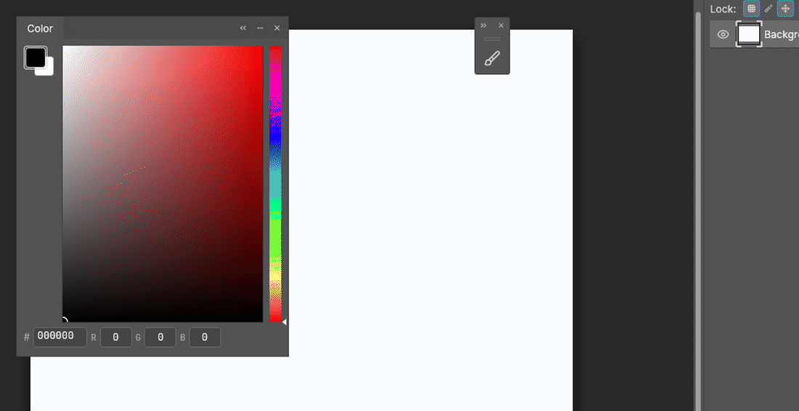

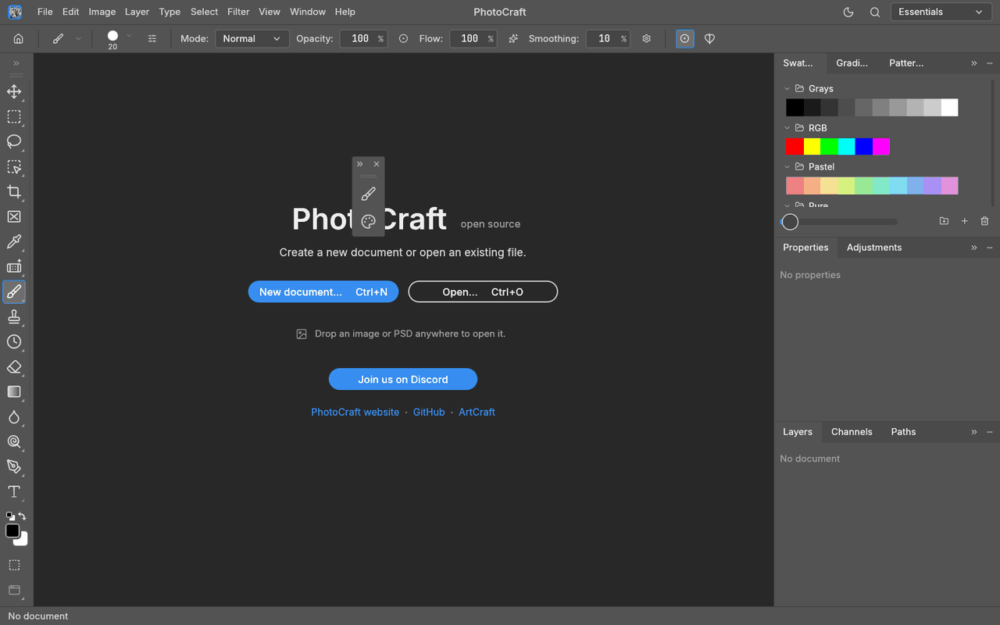

Resizing and Tools (4 GIFs)

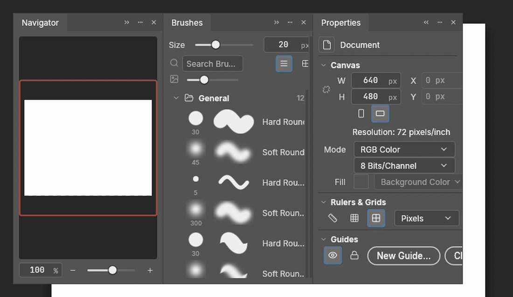

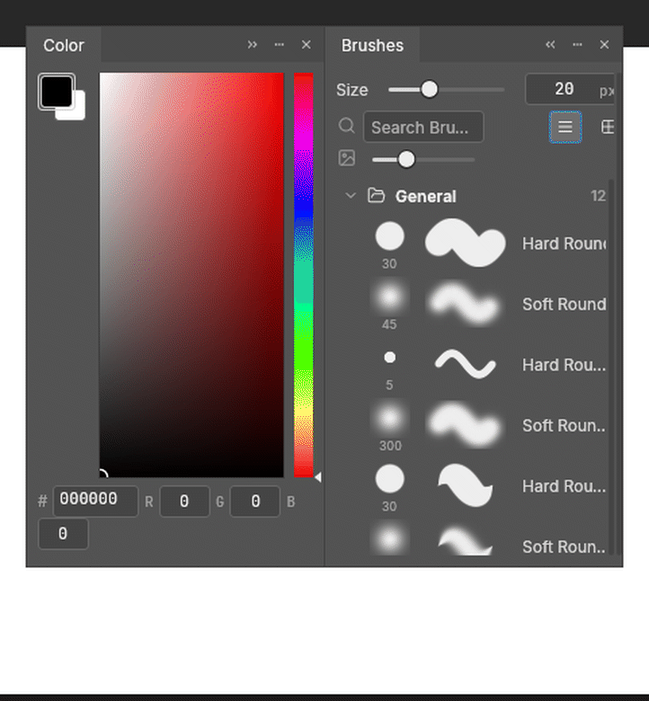

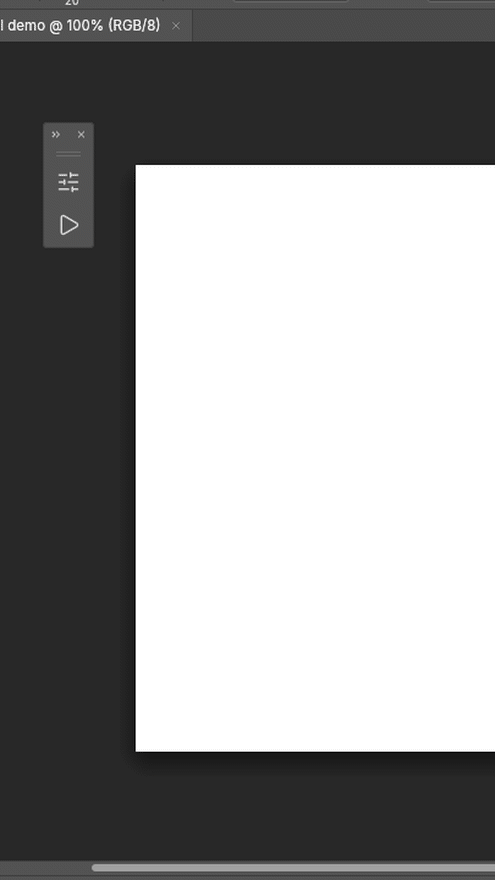

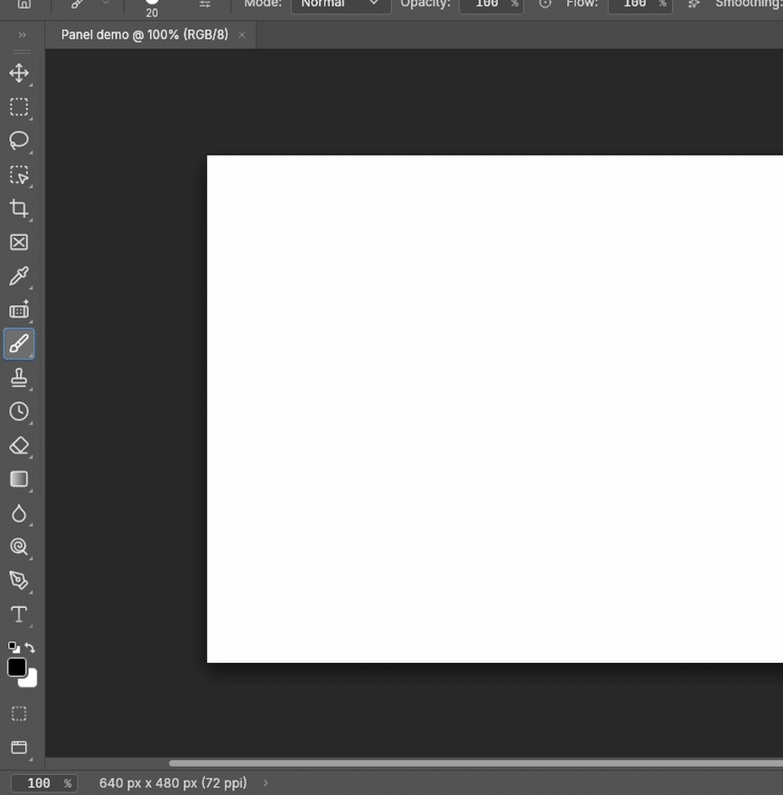

These are offscreen replays with synthetic blank documents, not native desktop video or latency measurements. Provenance and licenses are adjacent to the assets.

Related to #217.

<!-- This is an auto-generated comment: release notes by coderabbit.ai -->

<!-- coderabbit-ai-generated:v1 -->

## Summary by CodeRabbit

* **New Features**
  * Dock, float, resize, collapse, and rearrange panels and the Tools palette. Panel layouts and floating positions are saved with workspaces.
  * Hidden panels can temporarily reappear when you move the pointer to a screen edge, without changing their saved visibility.
  * Document tabs remain available as a distinct docking area.
* **Bug Fixes**
  * Improved restoration of older or unsupported panel layouts, preserving saved layout data when it can’t be loaded.
* **Documentation**
  * Added guides and validation notes for panel docking and workspace compatibility.

<!-- end of auto-generated comment: release notes by coderabbit.ai -->